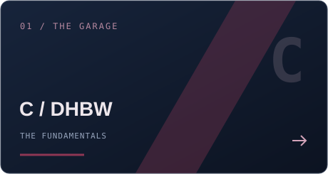
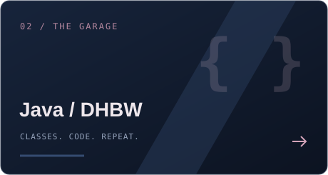
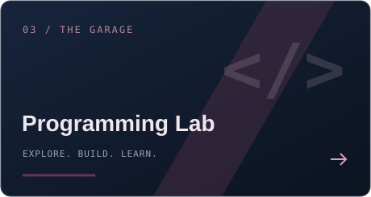
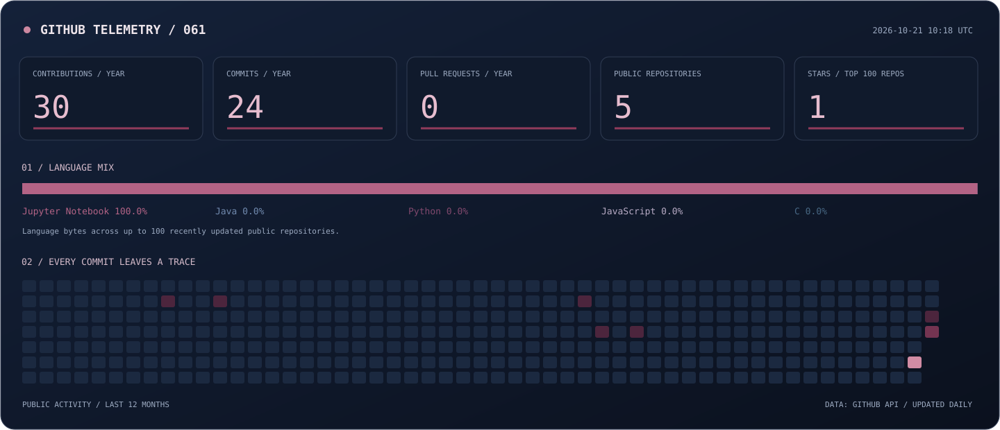

  

  

 

  
  
  

C &nbsp; / &nbsp; JAVA &nbsp; / &nbsp; GIT &nbsp; / &nbsp; GITHUB

<a href="https://github.com/asel-s61?tab=repositories"><strong>Explore the garage ↗</strong></a>

 

  

