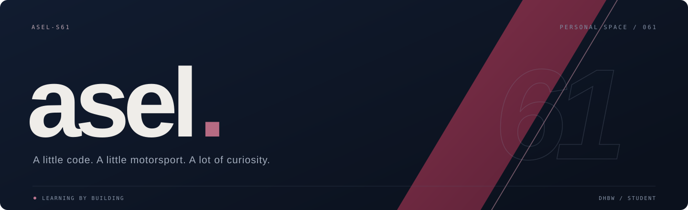
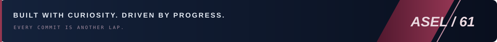

  

  <strong>DHBW STUDENT &nbsp; / &nbsp; CODE ENTHUSIAST &nbsp; / &nbsp; RACING MINDSET</strong>

  
  &nbsp;
  

---

### `01 / DRIVER BRIEFING`

Hey, I'm **Asel**. I study at **DHBW**, write code, and like things with a little horsepower.

This is my garage for university projects, experiments, and everything I learn along the way. The approach: build it, understand it, make it better. One lap at a time.

> **Clean lines. Better code. Always chasing the next lap.**

### `02 / UNDER THE HOOD`

  
  
  
  

### `03 / THE GARAGE`

| Project | Inside the garage |
| :--- | :--- |
| [**C / DHBW** ↗](https://github.com/asel-s61/asel_c_dhbw_students_2025) | My C programming coursework. |
| [**Java / DHBW** ↗](https://github.com/asel-s61/dhbw-java-2020) | My Java learning repository. |
| [**Scientific Programming Lab** ↗](https://github.com/asel-s61/Scientific_Programming_Lab) | My scientific programming workspace. |

---

  

